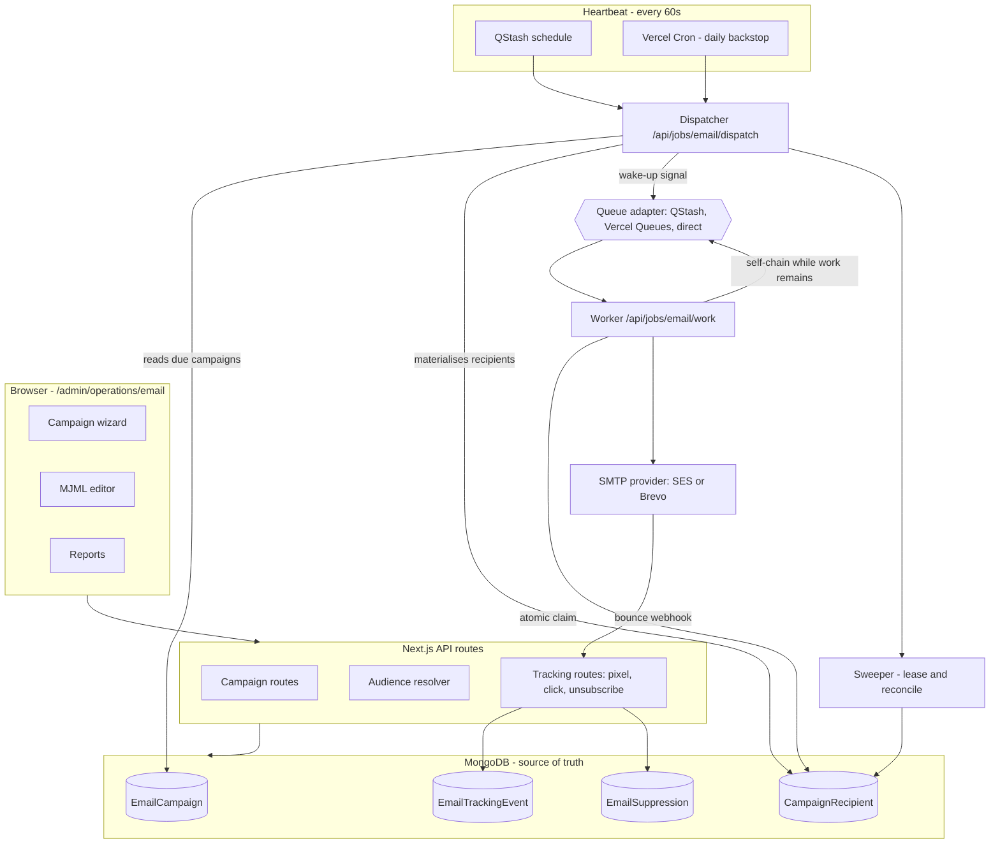
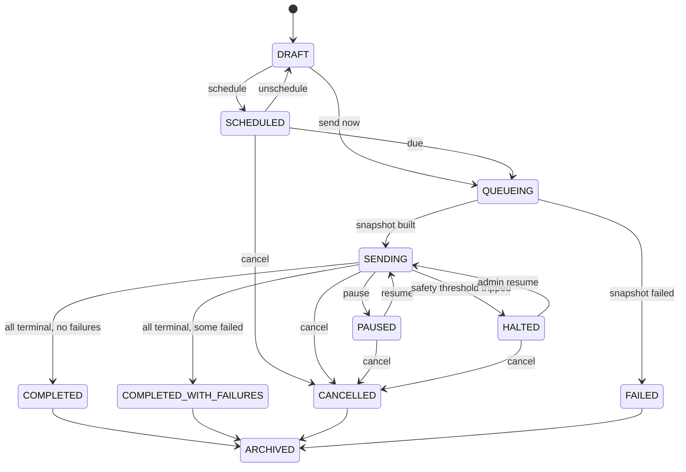
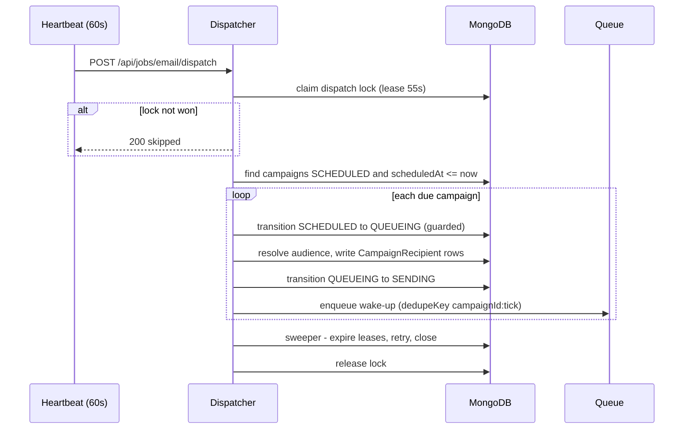
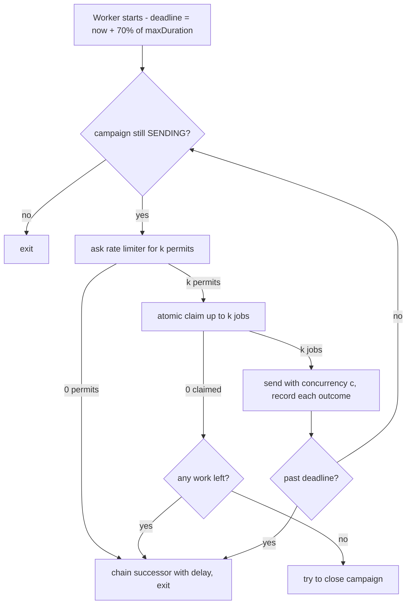
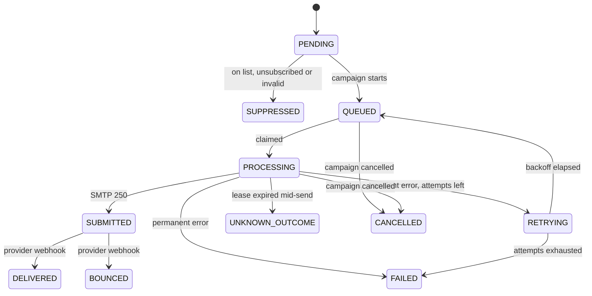
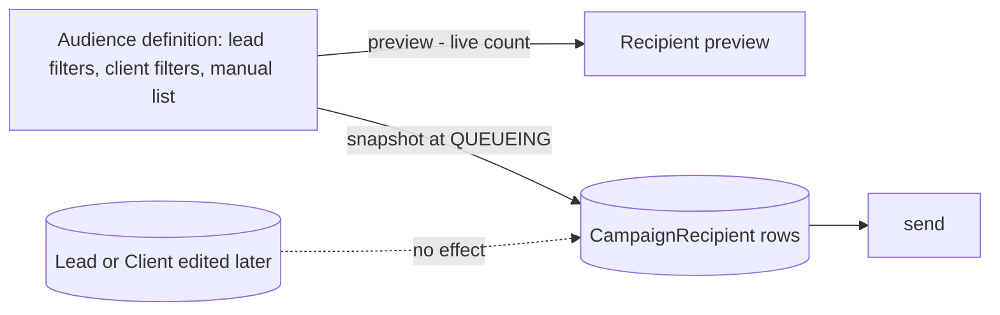
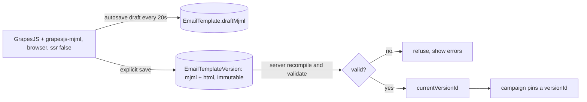

# Email Marketing — Architecture

> **Decisions were made on 19 November 2026. Read [EMAIL_MARKETING_DECISIONS.md](EMAIL_MARKETING_DECISIONS.md) first.**
> The build targets Vercel Hobby, campaigns of up to 100 recipients, Gmail SMTP and no queue service.
> Where this document differs from that one, that one wins. This document holds the research and the full design.

Status: proposal. Nothing is built. Approve before implementation.

---

## 0. The three findings that shape everything

Read these first. They change the plan more than any design choice.

### 0.1 Vercel Hobby cannot host this, for two separate reasons

**Reason one: the licence.** Vercel's Terms of Service, section 4, says: "You shall only use the Services under a Hobby plan for your personal or non-commercial use." Zan CRM is the internal tool of a company. That is commercial use. Hobby is not a legal option, with or without this module.

**Reason two: the clock.** A scheduling engine needs a dispatcher that wakes up often. Hobby does not allow one.

| Trigger | Hobby | Pro |
|---|---|---|
| Vercel Cron Jobs (legacy) | once per day, ±59 min | once per minute, per-minute |
| Vercel Schedules (beta) | every 15 min, always ±15 min jitter | every minute, ±1 min |

A campaign scheduled for 10:00 would send between 10:00 and 10:59 on Hobby. That is not a product.

**Decision needed:** move to Vercel Pro, $20 per month. See `EMAIL_MARKETING_INFRASTRUCTURE.md` for the full comparison.

### 0.2 Gmail SMTP cannot send this mail

The app sends through `smtp.gmail.com` today. Google Workspace limits:

- 2,000 messages per day per user.
- 100 recipients per message over SMTP for POP/IMAP users.
- 3,000 unique external recipients per day.
- Over the limit, the account stops sending for up to 24 hours.

One 500-recipient campaign fits. Four do not. More importantly, Gmail is built for person-to-person mail, not bulk marketing. Marketing volume from the Workspace account risks the same account that carries staff mail and the booking flow.

**Decision needed:** pick a real sending provider. Amazon SES or Brevo. See `EMAIL_MARKETING_INFRASTRUCTURE.md` section 4.

### 0.3 The queue cannot hold the schedule

Every queue has a retention ceiling.

| Provider | Max message retention | Max delay |
|---|---|---|
| Vercel Queues (beta) | 7 days | 7 days, capped at retention |
| Upstash QStash (free) | — | 7 days |
| Upstash QStash (paid) | — | 1 year |

A campaign scheduled six weeks out cannot be a queue message. MongoDB holds the schedule. The queue only carries wake-up signals.

---

## 1. The one principle

**MongoDB is the truth. The queue is an accelerator.**

If every queue message vanished right now, the next dispatcher tick would find the work in MongoDB and rebuild it. Nothing would be lost except speed.

This rule decides every other question:

- The queue never holds campaign state. It holds "wake up and look at campaign X".
- Workers claim jobs from MongoDB, not from the queue. So the queue's "max 10 messages per receive" limit does not bound our batch size.
- Scheduling is a MongoDB query (`scheduledAt <= now`), not a delayed message.
- A deploy, a crash or a queue outage costs latency, never correctness.

---

## 2. System overview



---

## 3. Component responsibilities

| Component | Owns | Never does |
|---|---|---|
| **Dispatcher** | Finds due campaigns. Materialises the recipient snapshot. Promotes recipients to QUEUED. Emits wake-up signals. Runs the sweeper. | Send email. Hold a long loop. |
| **Worker** | Claims a bounded set of recipient jobs. Personalises. Sends. Records the outcome. Chains a successor. | Decide what is due. Own campaign lifecycle. |
| **Sweeper** | Expires dead leases. Moves crashed jobs to UNKNOWN_OUTCOME. Retries eligible failures. Closes finished campaigns. | Send email. |
| **Rate limiter** | One global budget per provider, shared by every worker. | Live in a worker's memory. |
| **Queue adapter** | `enqueue(signal, { delay, dedupeKey })`. One interface, several backends. | Carry campaign data. |
| **Transport factory** | One pooled Nodemailer transporter per process, per provider config. | Be created per email. |
| **Tracking routes** | Pixel, signed click redirect, unsubscribe. Public, unauthenticated, rate limited. | Trust any URL from the query string. |

---

## 4. Campaign lifecycle



Every transition goes through one function. No route sets `status` directly.

```ts
// src/lib/email/campaign/transition.ts
const ALLOWED: Record<CampaignStatus, CampaignStatus[]> = { /* the map above */ }

export async function transitionCampaign(
    id: Types.ObjectId,
    to: CampaignStatus,
    by: AuthUser,
    reason?: string
): Promise<ICampaign>
```

It uses a guarded `findOneAndUpdate` with `status: { $in: allowedFrom }`. A concurrent pause and cancel cannot both win.

**Why `QUEUEING` is its own state.** Building a 500-row snapshot takes time. Without a state between SCHEDULED and SENDING, a second dispatcher tick 60 seconds later would start building the same snapshot again.

**Why `HALTED` is not `PAUSED`.** `PAUSED` is a person's choice. `HALTED` is the safety system stopping the campaign because the provider started refusing mail. They need different alerts and different resume rules.

---

## 5. Scheduling flow



### Time zones

The app already has `wallTimeToUtc(wall, timeZone)` in `src/lib/time/zone.ts`. Use it. No new time code.

Store three fields, never two:

```ts
scheduledAt: Date      // UTC. The only field any query uses.
scheduleWall: string   // "2026-12-01T09:30". What the person typed.
scheduleZone: string   // "Asia/Kolkata". IANA name.
```

Keeping the wall time and the zone means the UI can show "9:30 AM IST" after the fact without guessing, and a reschedule starts from what the person meant.

**Daylight saving.** `wallTimeToUtc` resolves the wall time against the zone's offset on that date. A campaign set for 2:30 AM on a spring-forward night has no such instant. The validator refuses it at schedule time and says why. It does not silently shift.

### Duplicate dispatcher protection

One lock document, claimed with a lease:

```ts
await EmailDispatchLock.findOneAndUpdate(
    { _id: "dispatch", $or: [{ leaseUntil: { $lte: now } }, { leaseUntil: null }] },
    { $set: { leaseUntil: new Date(now.getTime() + 55_000), owner: workerId } },
    { upsert: true, returnDocument: "after" }
)
```

Two ticks 200 ms apart: one wins, one returns `200 skipped`. The lease expires on its own, so a crashed dispatcher does not block the next tick forever.

---

## 6. Delivery engine

### 6.1 The four levels

```
Campaign  ->  Logical Batch  ->  Recipient Job  ->  Worker Execution
  (1)            (1..n)            (1..n)            (claims k)
```

- **Logical batch** is for people. "Batch 3 of 5 finished, 2 failures." It groups 100 recipients. It does no work.
- **Recipient job** is one `CampaignRecipient` document. It is the unit that is claimed, leased, retried and reported.
- **Worker execution** claims `k` jobs, sends them, then decides whether to loop again or chain a successor.

### 6.2 Worker loop



**Why the worker loops instead of one claim per invocation.** A 300-second function that sends five emails and exits wastes an invocation and a warm SMTP connection. The loop keeps the pooled connection alive and reuses the warm instance. The 70% safety margin leaves room to finish in-flight sends and write their results.

### 6.3 The atomic claim

Three operations, no over-claiming, no transaction:

```ts
const claimId = new Types.ObjectId()
const now = new Date()

// 1. candidates
const ids = await CampaignRecipient
    .find({ campaignId, status: RECIPIENT_STATUS.QUEUED })
    .sort({ _id: 1 }).limit(k).select("_id").lean()

// 2. claim - the status guard makes a lost race harmless
await CampaignRecipient.updateMany(
    { _id: { $in: ids.map(r => r._id) }, status: RECIPIENT_STATUS.QUEUED },
    {
        $set: {
            status: RECIPIENT_STATUS.PROCESSING,
            claimId,
            leaseOwner: workerId,
            leaseUntil: new Date(now.getTime() + leaseMs),
            lastAttemptAt: now,
        },
        $inc: { attempts: 1 },
    }
)

// 3. what we actually won
const jobs = await CampaignRecipient.find({ claimId })
```

If two workers pick the same candidate, exactly one `updateMany` matches `status: QUEUED`. The loser simply gets fewer jobs. No error, no duplicate.

### 6.4 Global rate limiting

Nodemailer's `rateLimit` applies to one transporter in one process. Ten concurrent workers with `rateLimit: 10` send 100 per second, not 10. That is the bug named in the brief, and it is real.

The limiter is a MongoDB fixed-window counter, claimed in bulk:

```ts
// src/lib/email/delivery/rateLimiter.ts
export async function takePermits(
    providerKey: string,
    want: number,
    perSecond: number
): Promise<number> {
    const bucket = Math.floor(Date.now() / 1000)
    const _id = `${providerKey}:${bucket}`

    const doc = await EmailRateCounter.findOneAndUpdate(
        { _id },
        { $inc: { used: want }, $setOnInsert: { expiresAt: new Date(Date.now() + 120_000) } },
        { upsert: true, returnDocument: "after" }
    )

    const overshoot = Math.max(0, doc.used - perSecond)
    const granted = Math.max(0, want - overshoot)
    if (granted < want) {
        await EmailRateCounter.updateOne({ _id }, { $inc: { used: granted - want } })
    }
    return granted
}
```

One round trip for a whole batch, not one per email. The counter has a TTL index, so old buckets clean themselves up.

A daily budget uses the same function with a day-keyed bucket. Both are checked: per-second and per-day.

**Why MongoDB and not Redis.** No new service, no new credentials, and at 10 to 50 sends per second the write load is nothing. The function signature hides the storage, so swapping in `@upstash/ratelimit` later touches one file.

### 6.5 SMTP transport

```ts
// src/lib/email/delivery/transport.ts
let cached: { key: string; transporter: Transporter } | null = null

export function getTransport(config: ProviderConfig): Transporter {
    const key = configFingerprint(config)
    if (cached?.key === key) return cached.transporter

    cached?.transporter.close()
    cached = {
        key,
        transporter: nodemailer.createTransport({
            host: config.host,
            port: config.port,
            secure: config.port === 465,
            auth: { user: config.user, pass: decrypt(config.passCipher) },
            pool: true,
            maxConnections: config.maxConnections,   // start at 1
            maxMessages: config.maxMessages,         // start at 100
            rateDelta: 1000,
            rateLimit: config.perProcessPerSecond,   // local backstop only
        }),
    }
    return cached.transporter
}
```

Module scope, so Fluid Compute's shared instance reuses it across concurrent invocations. Vercel's docs confirm several invocations can share one process, so the pool survives between wake-ups on a warm instance. It is not guaranteed across instances. That is exactly why the real limit is the distributed one above, and `rateLimit` here is only a local backstop.

**Every recipient gets their own message.** One `sendMail` per recipient, one address in `to`, nothing in `cc` or `bcc`. The code has no path that puts two recipients in one message.

### 6.6 Recipient state machine



`SUBMITTED` means the SMTP server said 250. It does not mean the mail arrived. `DELIVERED` means the provider's webhook confirmed it. **The dashboard shows these as two separate numbers and never adds them together.** Without a provider webhook, `DELIVERED` stays at zero and the UI says "your provider does not report delivery" rather than showing a fake figure.

### 6.7 The crash-after-accept problem

This is the hardest part of the design. It deserves a plain answer.

The sequence that hurts:

1. Worker sends. SMTP returns 250. The email is on its way.
2. The function is killed before the database write.
3. The lease expires.
4. The sweeper sees a `PROCESSING` job with a dead lease.

If the sweeper puts it back in `QUEUED`, that person gets the email twice.

**What we do.** The sweeper moves it to `UNKNOWN_OUTCOME`, never to `QUEUED`. The default policy is not to resend. The campaign report shows the count plainly: "3 recipients - we cannot confirm whether the mail was sent."

**What narrows the window.** Before calling `sendMail`, the worker writes a deterministic `Message-ID` it generated itself:

```
<cmp-{campaignId}-rcp-{recipientId}-a{attemptNo}@{sendingDomain}>
```

The ID is written to MongoDB before the send. So after a crash the ID is known. If the provider offers a message-lookup API or a webhook keyed on Message-ID, a reconciler resolves `UNKNOWN_OUTCOME` to `SUBMITTED` or back to `QUEUED` with certainty. With Amazon SES this works. Without a provider API, the row stays `UNKNOWN_OUTCOME` and a human decides from the operations screen.

**What we will not claim.** SMTP has no idempotency key. There is no exactly-once delivery over SMTP, from any provider, in any design. The honest guarantee is:

> At-least-once attempt scheduling, at-most-once send per (job, attempt) while the lease holds, and a bounded, visible count of attempts whose outcome is genuinely unknown.

That sentence goes in the operations documentation and in the UI tooltip. We do not write "guaranteed delivery" anywhere.

### 6.8 Retry classification

| Class | Examples | Action |
|---|---|---|
| `PERMANENT` | 550 no such user, 553 bad address, invalid domain | FAILED. No retry. Add to suppression if it is a hard bounce. |
| `TRANSIENT` | 421, 451, connection reset, timeout | RETRYING, up to 5 attempts. |
| `THROTTLE` | 454 too many, provider rate error | RETRYING, up to 5, and the global limiter halves its rate for 60 seconds. |
| `AUTH` | 535 bad credentials | HALT the campaign. Alert an admin. Do not retry. |
| `UNKNOWN` | anything unmatched | TRANSIENT, max 3. |

Backoff is exponential with jitter: `min(maxDelay, base * 2^attempt) * (0.5 + random()/2)`.

The jitter matters. Without it, 50 failed jobs all retry at the same instant and hit the provider together.

---

## 7. Audiences and the snapshot rule

A campaign that is scheduled holds a **snapshot**. The audience definition is kept for reference, but the recipient rows are frozen.



Change a lead's email tomorrow, and yesterday's scheduled campaign still sends to the address captured at snapshot time. That is correct: the recipient count the person approved must be the count that is sent.

The snapshot pipeline:

```
resolve  ->  normalise  ->  validate  ->  deduplicate  ->  suppression check  ->  consent check  ->  write rows
```

- **normalise**: lowercase, trim, strip the `+tag` only if a setting says so (off by default - `a+news@x.com` is a real distinct mailbox).
- **validate**: syntax plus a rejected-domain list. No MX lookup during snapshot - too slow for 500 rows and it is not conclusive.
- **deduplicate**: unique index on `{ campaignId: 1, emailNormalized: 1 }`. The write is an unordered bulk insert, so a duplicate is skipped, not an error.
- **suppression**: checked here and again in the worker immediately before the send. Somebody can unsubscribe between snapshot and send.

---

## 8. Templates and the MJML editor

**MJML is the source of truth. Compiled HTML is a build artefact.**



**Server recompile is not optional.** The browser compiles for preview. The server compiles again before saving a version, with `mjml@4.18.0`. If the two disagree, the server wins and the save is refused with the errors shown. The client is not trusted to produce the HTML we send.

**Version pinning.** A campaign stores `templateVersionId`, not `templateId`. Edit the template after scheduling and the scheduled campaign is untouched.

**Preview isolation.** Generated HTML never touches the app's DOM. Previews render in a sandboxed iframe:

```html
<iframe sandbox="allow-same-origin" srcdoc={html} />
```

No `allow-scripts`. No `allow-top-navigation`. No `allow-forms`.

**Version pin on MJML.** `grapesjs-mjml@1.0.8` depends on `mjml-browser@^4.18.0`, the 4.x line. The latest `mjml` is 5.4.1 and is **not** in that range. Install `mjml@4.18.0` on the server so browser and server compile identically. Pin both exactly. This mismatch is the kind of thing that produces "it looked fine in the editor" bug reports six months later.

---

## 9. Personalisation

One engine, used by preview, test send and the worker.

```ts
// src/lib/email/personalise/render.ts
export function renderMerge(
    source: string,
    data: MergeData,
    fallbacks: Record<string, string>
): { text: string; missing: string[] }
```

Syntax: `{{first_name}}`, with a per-variable fallback configured on the campaign.

**Not Handlebars.** A full template engine run over attacker-adjacent content is a bigger surface than we need. The variable set is closed and known. A whitelist replacer over a fixed token list is simpler and cannot execute anything.

| Token | From | Fallback example |
|---|---|---|
| `{{first_name}}` | first word of `name` | "there" |
| `{{name}}` | `name` | "there" |
| `{{email}}` | the recipient address | - |
| `{{company}}` | Client `company`, Lead source company | "your company" |
| `{{lead_source}}` | `Lead.source` | "" |
| `{{unsubscribe_url}}` | generated, always available | - |

Values are HTML-escaped on insertion. A lead named `<script>` cannot inject anything.

The merge data is **snapshotted onto the recipient row**, not read from the Lead at send time. One read at snapshot, none during sending. That is both faster and consistent with section 7.

---

## 10. Tracking

### Open pixel

`GET /api/e/o/[token].gif` returns a 1x1 transparent GIF, always, in every case. Even for an invalid token. A tracking endpoint that returns 404 for bad tokens is an oracle.

### Click redirect

`GET /api/e/c/[token]?u=<base64url>`

```ts
// the only acceptable redirect check
const target = decodeTarget(u)
if (!signatureValid(token, u)) return notFound()
if (!/^https?:$/.test(target.protocol)) return notFound()
if (!allowedHost(target.hostname)) return notFound()   // allow-list from campaign links
return NextResponse.redirect(target, 302)
```

The destination list is built when the template version is saved. The redirect only ever goes to a URL that was in the compiled HTML of that version. A URL that was not in the template cannot be reached through our redirect, whatever the query string says. That closes open redirect completely.

The token is `HMAC-SHA256(campaignId:recipientId:linkIndex, TRACKING_SECRET)`, truncated. It is not guessable and it is not reversible.

### Events

`EmailTrackingEvent` is a separate collection with a TTL index. Nothing is embedded in the campaign document.

Counters are kept on `CampaignRecipient` and `EmailCampaign` with `$inc`, so reports do not aggregate millions of rows. "Unique opens" is `CampaignRecipient.countDocuments({ campaignId, openCount: { $gt: 0 } })`, one indexed count.

### Honesty about opens

Apple Mail Privacy Protection and corporate image proxies fetch the pixel without a human reading anything. Gmail caches images, so a second open may not register. Opens are **directionally useful and numerically wrong**, and the UI says so, next to the number, not buried in a help page.

Clicks are reliable. The deliverability dashboard leads with clicks.

---

## 11. Security

| Control | How |
|---|---|
| Auth | `requireRole(req, EMAIL_ACCESS_ROLES)`. Same as every other module. |
| Region | `regionScopePlugin` on every new model. A US campaign is invisible to an IN user, with no extra code. |
| Ownership | Non-managers may only edit campaigns where `createdBy` is them. |
| SMTP secrets | `EmailProviderConfig.passCipher`, AES-256-GCM, key in `EMAIL_SECRET_KEY`. Never serialised to any API response. The settings UI shows dots and a "test connection" button. |
| Job endpoints | `/api/jobs/email/*` require a `x-job-secret` header checked with `timingSafeKey` (already in `src/lib/security`). Not reachable from a browser. |
| Upload validation | MIME sniff on bytes, not the filename. Images only. 5 MB cap. |
| MJML validation | Server-side compile. Refuse on error. Strip `<script>`, style with expressions, and event attributes from the compiled HTML. |
| Tracking tokens | HMAC, not an ObjectId in the URL. |
| Redirects | Allow-list from the template version. See section 10. |
| Rate limits | Public tracking routes capped per IP. |
| Audit | `ensureAuditPlugin` on campaign, template, audience, suppression and provider config. The existing activity log picks it up. |
| Kill switch | One flag in `EmailProviderConfig`. The worker reads it before every claim. Set it and all sending stops within one claim cycle. |

### Consent and the law

- **India, DPDP Act 2023.** Consent must be specific to the purpose and withdrawable as easily as it was given. Marketing consent cannot be bundled into the consent for being a customer. A pre-existing list needs a notice.
- **GDPR**, for any EU recipient. Lawful basis recorded, withdrawal honoured.
- **CAN-SPAM**, for US recipients. A real postal address in the footer, working unsubscribe honoured within 10 days.

What we build:

1. `marketingConsent` on `EmailContact`, and a derived eligibility check for Leads and Clients. The default for CRM records is a decision for you - see the open questions.
2. One-click unsubscribe link in every marketing email, plus the `List-Unsubscribe` and `List-Unsubscribe-Post` headers.
3. Unsubscribe writes to `EmailSuppression` immediately. It is scoped to the sending domain and applies to every future campaign.
4. The sender identity carries a postal address, and the default footer block includes it.
5. Suppression is checked at snapshot and again at send.

This plan is not legal advice. Have the DPDP consent wording reviewed before the first real campaign.

---

## 12. Safety thresholds

Configured per provider, checked by the worker after every claim cycle:

| Signal | Default | Action |
|---|---|---|
| Auth failure (535) | 1 occurrence | HALT campaign, alert admin |
| Hard bounce rate | over 5% of 100+ sent | HALT campaign, alert admin |
| Throttle responses | over 20% in 60s | halve the global rate for 5 minutes |
| Consecutive connection failures | 10 | HALT campaign, alert admin |
| Daily budget reached | configured | pause the campaign until the next window |

The alert uses the existing `emitNotification`, so it lands in the bell and as a push. No new notification channel.

---

## 13. Why this survives a move off Vercel

The brief asked that worker logic not be tied to Vercel. It is not.

| Concern | How it is kept portable |
|---|---|
| Heartbeat | An HTTP POST to `/api/jobs/email/dispatch`. QStash, Vercel Cron, a GitHub Action or a `cron` line on any box can send it. |
| Queue | One `QueueAdapter` interface. QStash today, Vercel Queues or BullMQ later. Nothing above it knows which. |
| Worker | A plain POST handler with a secret header. It runs identically on Fly, Render, a VPS or a container. |
| Duration | The worker reads its own budget from config, not from a Vercel constant. |
| Storage | ImageKit, already in the app. Not the function filesystem. |

Moving to a dedicated worker later means: point the heartbeat elsewhere, swap the adapter, raise the duration budget. No redesign.

---

## 14. Open decisions

These need your answer before implementation starts.

1. **Vercel Pro.** $20/month. Required for commercial use regardless of this module. Approve?
2. **Sending provider.** Amazon SES (cheapest, most work, best reconciliation) or Brevo (easiest, bundled marketing features). The full comparison is in `EMAIL_MARKETING_INFRASTRUCTURE.md` section 4.
3. **Consent default for existing CRM records.** Are current Leads and Clients eligible for marketing email, or do they need a re-permission campaign first? This is the DPDP question and it is a business decision, not a technical one.
4. **Scope of milestone 1.** The full list in the brief is about 14 weeks of work. The suggested first release is in `EMAIL_MARKETING_IMPLEMENTATION_PLAN.md` section 2.
5. **Roles.** Which roles may create, approve and send campaigns? Draft proposal in the implementation plan, section 3.
